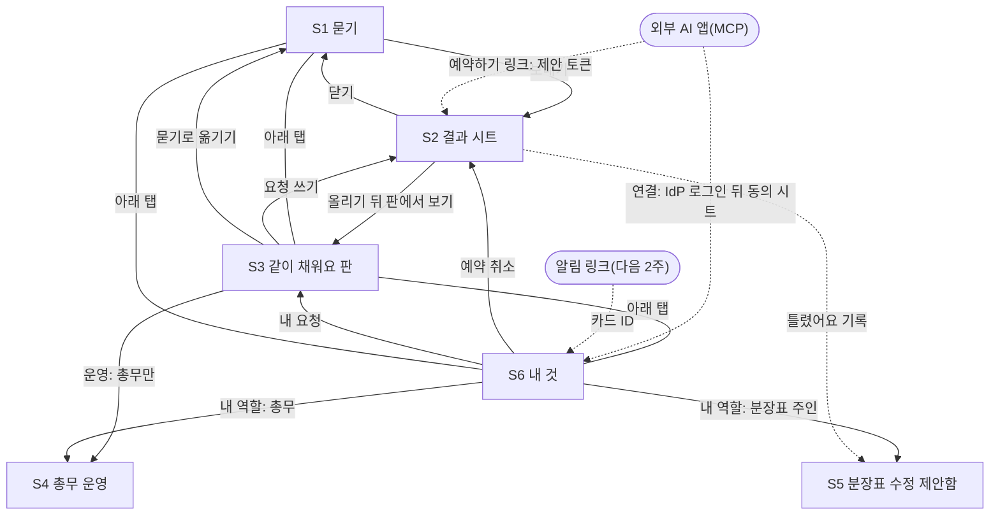

# 화면 설계: 한 줄 데스크

> 상태: 작성됨(디자이너 에이전트), 교차 검토·MCP 결정 반영. 기준: `회의/03_결정.md` D1~D13, `회의/05_수정지시.md` R1~R18, `회의/08_MCP_결정.md` M1~M7, 화면 번호 S1~S6 (2026-10-23).
> 이번 2주 범위: 읽기 전용 MCP 도구 둘(빈 회의실 찾기 · 공지 찾기)을 더하지만 새 S 번호는 없어요. 공지는 찾기 + 원문 링크만(D13 ①), S5는 기록 목록 + 파일 다시 올리기만(D13 ②), 판은 몇 초마다 새로고침, 알림은 다음 2주예요(M6).
> 범위: 구조와 흐름을 다뤄요. 색·글꼴·간격 토큰은 10/26 "디자인 기준" 절에서 정했어요.
> 기준 기기: 폰 세로 화면, 한 손 사용. S4·S5는 PC 우선이고, 폰에서는 요약과 확정·저장만 해요.
> **2026-10-26 화면 구조 변경(사용자 결정, ADR-02 개정):** S1 묻기(앞문)를 없애고 기능별 페이지로 나눴어요. 아래 탭은 홈 · 담당 찾기 · 회의실 · 공지 · 같이 채워요 · 내 것이에요. 아래 "10/26 화면 구조" 절이 이 문서의 S1·S2 설명보다 앞서요.

## 10/26 화면 구조

- **홈**(10/26 디자인 기준으로 고침): 위 막대(서비스 이름 · 알림 종) → 부서 · 층 → "○○님, 무엇을 할까요?" → 할 수 있는 일 목록 하나(아이콘 · 기능 이름 · 한 줄 설명 · ›, 줄을 누르면 그 기능 페이지) → 내 예약 · 내 요청 요약. 예시 문장은 기능 페이지에만 있어요. 꺼진 기능의 줄은 숨겨요.
- **기능 페이지(담당 찾기 · 회의실 · 공지)**: 기능 이름(작은 글씨) → 질문 하나인 큰 제목 → 한 줄 설명 → 입력 칸(머리 자물쇠 + "나만 보여요", 큰 입력 칸 아래 큰 버튼 [담당 찾기]·[빈 방 찾기]·[공지 찾기]) → "이렇게 써 보세요" 예시 문장 칩(옆으로 밀기) → 결과 카드(시트가 아니라 페이지 안). 입력 칸 아래 "무엇을 남기나요" 링크는 10/26 사용자 결정으로 뺐어요(저장 범위는 내 것 페이지에서 봐요). 회의실 페이지 아래에는 내 예약, 담당 찾기 페이지 아래에는 분장표 주인에게만 [분장표 수정 제안함]이 있어요.
- **담당 찾기 문의 보내기(10/26, ADR-16)**: 담당 카드 보조 버튼 [○○에 문의하기](못 찾음 카드는 [총무팀에 문의하기]) → 양식 시트: "○○에게 보내져요 · 업무 이름" → 문의 내용(찾던 문장이 미리 채워짐, 1,000자) → 사유(500자) → 입력 칸 아래 잠금·가림 줄 → [보내기] → 확인 시트("○○에 보낼까요?" · 업무 · 받는 곳(팀 창구) · "내 이름과 부서가 같이 가요. 답을 받으려면 필요해요." · "보낸 글은 ○○이 읽고, 90일 동안 보관돼요") → "○○에 보냈어요" 확정 카드. 담당 찾기 페이지 아래: **우리 팀에 온 문의**(분장표에 행이 있는 부서만, 보낸 사람 이름·부서·시각·문의·사유·상태 배지, [확인했어요]·[처리했어요]), **내 문의**(받는 팀·업무·상태·시각).
- **알림 종(10/26, ADR-16)**: 모든 화면 위 오른쪽 종 + 읽지 않은 수. 누르면 알림 시트(굵은 글 = 안 읽음, [모두 읽음], 누르면 그 페이지로 가고 읽음). 새 알림이 오면 아래쪽 토스트 "🔔 인사팀에 새 문의가 왔어요 · 재직증명서 발급". 알림 글에는 문의 내용이 없어요("알림에는 내용이 없어요. 누르면 그 페이지에서 볼 수 있어요. 30일 지나면 지워져요").
- **회의실 페이지 "모든 회의실"(10/26)**: 날짜 칩(오늘·내일·모레) · 층 칩(내 층 표시) · 인원 칩 · "지금 빈 방만" → 방 카드(그림 · 이름 · 층 · 정원 · 지금 상태 배지 · 장비), 내 층 방이 먼저예요. 상태 배지: "지금 비어 있어요 · HH:MM부터 예약" / "사용 중 · HH:MM부터 비어요" / 다른 날은 "예약 N건" · "예약 없음". 카드를 누르면 **방 자세히** 시트: 큰 그림 → 층 · 정원 · 상태 → 설비 목록 → 예약 현황(날짜 칩, 07:00~22:00 30분 칸, 남의 예약은 "예약됨 HH:MM~HH:MM", 내 예약은 "내 예약" + [취소], 지난 칸은 흐리게) → 빈 칸을 눌러 시작 시각, 길이(30·60·90·120분) → [이 시간 확인] → 비면 [이 시간으로 예약] 카드, 차 있으면 "그 시간에는 이미 예약이 있어요" + 같은 방 가까운 시간 대안 → 확인 시트 [예약하기]. 그림에는 "그림" 표시가 있어요(실제 사진은 장부에서 받아요).
- **회의 참석자 초대(10/26, ADR-17)**: 확정 카드 주 버튼 [참석자 초대] · [캘린더 파일 받기] · [취소]. 양식 시트: 회의(방·시간) → "이름이나 부서로 찾기"(최대 8명 결과, 이름·부서·층, [추가]) → 고른 사람 칩(누르면 빼기, n/20명) → 알릴 길(앱 안 알림 늘 · 그룹웨어 캘린더 초대 · Slack DM) → [n명에게 알리기] → 확인 시트("n명에게 알릴까요?" · 방·시간 · 이름들 · "고른 사람만 방·시간·내 이름을 봐요" · 바깥 길 안내) → 결과 카드(앱 알림 n명 · 그룹웨어 캘린더 n명 · Slack DM n명, [캘린더 파일 받기]). 내 예약: 참석자 이름(답) 한 줄 · [참석자 초대] · [캘린더 파일] · [취소]. 회의실·내 것의 **나를 부른 회의**: 방·층 · 시간 · "○○(부서)님이 불렀어요" · 답 배지 · [참석할게요]·[못 가요]·[캘린더 파일]. 내 것의 **시연 받은편지함**(모의일 때만): 그룹웨어 캘린더(모의) 일정 · Slack DM(모의) 글.
- **회사 계정 로그인(임시 IdP, 10/26)**: IdP 모드면 로그인 화면이 "회사 계정으로 들어가기" · "회사 IdP 로그인 화면으로 갔다가 돌아와요. 이 앱은 비밀번호를 보지 않아요" · [회사 계정으로 로그인]이에요. 돌아오면 보던 화면(예: AI 앱 연결 동의)으로 가요. 실패하면 "로그인하지 못했어요. 한 번 더 해 주세요."
- **같이 채워요(S3)·내 것(S6)**: 그대로예요. 판의 담당 질문은 [담당 찾기로 옮기기]로 담당 찾기 페이지에 문장을 넘기고 바로 찾아요.
- **옮겨 가기**: "틀렸어요 → 종류가 달라요", 공지 [담당 찾기에서 찾기], 판 [담당 찾기로 옮기기]는 같은 문장을 그 기능 페이지로 넘기고 바로 찾아요. 문장은 앱 메모리로만 넘겨요.
- **로그인(시연)**: 앱 표시 → "회사 일, 이제 한 줄이면 돼요" → 한 줄 설명 → "가상 직원으로 들어가기" 목록(이름 첫 글자 동그라미 · 이름 · 부서 · 층 · 볼 수 있는 화면 한 줄, 예: "총무 — 같이 채워요 운영(합치기·주문안)도 볼 수 있어요" · ›).
- **공통 띠**: "시연 데이터로 돌아가는 중이에요 · 자세히/접기"(누르면 모의 데이터 목록).

- 역할(R7): 직원 / 총무(S4) / 분장표 주인(S5, 자기 부서 행만) / 운영자(S1~S6에 전용 화면 없음, 운영 설정만).
- 종류: 담당·공지·회의실·탕비실·모름(코드 `navi · notices · rooms · pantry · unknown`).
- 공통 띠(R6): 모의 어댑터가 하나라도 켜져 있으면 모든 화면 위쪽에 "시연 데이터로 돌아가는 중이에요 · 자세히" 띠 하나를 둬요. 누르면 어떤 데이터가 모의인지 목록이 떠요.

## 디자인 기준(10/26)

사용자 요청으로 화면 전체를 다듬었어요. 기준은 "본능적인 직관성 · 1화면 1행동 · 사용자 쪽 말"이에요. 아래 "보안이 보이는 문구" 표와 카드 머리 라벨(제안·확정·안내·막힘)은 그대로 써요.

- **한 화면, 한 질문**: 기능 페이지 큰 제목은 그 화면이 묻는 질문 하나예요(담당 찾기 "어떤 일인지 한 줄로 알려 주세요", 회의실 "언제, 몇 명이 쓰나요?", 공지 "어떤 공지를 찾나요?", 같이 채워요 "우리 층 탕비실에 뭐가 필요해요?"). 기능 이름은 제목 위 작은 글씨예요.
- **주 버튼은 하나**: 화면마다 파란 큰 버튼은 하나예요. 보조 행동은 연한 파랑, 닫기·로그아웃은 회색, 덜 쓰는 행동(모든 기기에서 로그아웃)은 글자 링크예요. 같이 채워요 판의 +1은 연한 파랑, 표 거두기는 회색이에요.
- **버튼은 결과를 말해요**: [찾기] 대신 [담당 찾기]·[빈 방 찾기]·[공지 찾기], 같이 채워요는 [미리 보기], 방 자세히는 [HH:MM~HH:MM 예약할 수 있는지 보기]예요.
- **토큰**: 바탕 옅은 회색(#F2F4F6), 카드 흰색, 선 대신 면의 밝기로 나눠요. 주 파랑 #1E6EE8(흰 글자와 4.5:1 넘음), 글자 파랑 #1659C7. 모서리 카드 20 · 버튼·입력 14 · 작은 것 10, 옆 여백 20. 어두운 화면 토큰도 같이 있어요(`styles.css` `:root`).
- **글꼴**: Pretendard(OFL)를 앱 안에 넣었어요(`pretendard` 패키지, 쓰는 글자 묶음만 받아요). 바깥 글꼴 서버를 부르지 않아요.
- **크기**: 큰 제목 26 · 섹션 제목 18 · 본문 16 · 보조 14 · 작은 글씨 13. 주 버튼·입력 칸 높이 56(한 손 엄지).
- **아이콘**: 선 아이콘 한 벌(`components/Icon.tsx`, 글자색을 따라가요). 아래 탭은 아이콘 + 이름, 지금 탭은 진한 글자예요. 홈 목록은 기능마다 옅은 색 바탕 아이콘이에요.
- **움직임**: 시트는 아래에서 올라오고, 결과 카드는 살짝 떠오르고, 버튼은 누르면 조금 작아져요. "움직임 줄이기"를 켠 기기에서는 모두 꺼요.
- **시트·토스트**는 화면 맨 바깥(body)에 그려서 위 막대·아래 탭에 갇히거나 가리지 않아요.

## 화면 흐름

| 출발 | 동작 | 도착 |
|---|---|---|
| S1 | 예시 문장 칩 누르기 | S1 (입력창에 채우기만 해요. 보내지 않아요) |
| S1 | 입력창에 쓰고 보내기 | S2 (바닥 시트) |
| S2 | 닫기, 아래로 밀기, 뒤로 가기 | 열었던 화면(S1·S3·S6) |
| S2 | 게시 뒤 [판에서 보기] | S3 (올린 줄로 스크롤) |
| S2 | 담당 카드 "틀렸어요" → 선택 | S2 안에서 카드 교체. 기록은 예측 행 주인의 S5로 가요 |
| S3 | 요청 쓰기 칸에 쓰고 보내기 | S2 (공개 미리보기 카드) |
| S3 | 담당 질문 감지 → [묻기로 옮기기] | S1 (글은 앱 메모리 상태로만 옮겨요. URL·브라우저 저장소에 두지 않아요) |
| S3 | 머리의 [운영] (총무만 보여요) | S4 |
| S6 | 내 예약 [취소] | S2 (확인 시트) |
| S6 | 내 요청 누르기 | S3 (그 품목 줄) |
| S6 | "내 역할" 칸의 [운영] · [수정 제안함] | S4 · S5 (역할 있는 사람만 보여요) |
| 아래 탭 | 묻기 / 같이 채워요 / 내 것 | S1 / S3 / S6 |
| 외부 AI 앱 | "한 줄 데스크 연결" → 사내 IdP 로그인 | S6 + 연결 동의 시트(우리 서버가 띄워요) |
| 외부 AI 앱 | 회의실 후보의 [한 줄 데스크에서 예약하기] 링크 | S2 (그 방 카드 한 장, 지금 다시 조회) |
| 알림 링크(다음 2주) | 누르기(로그인 뒤 돌아와요) | S6의 해당 요청 |

끄기 스위치에 따른 화면(R4). 스위치는 운영자가 운영 설정에서 바꾸고, 화면에는 설정 화면이 없어요.

| 스위치 | 화면 |
|---|---|
| 켬 | 위 흐름 그대로예요 |
| 링크만 | 그 종류로 분류되면 S2에 "이 일은 그룹웨어에서 해요" 링크 카드(안내)가 떠요 |
| 끔 | 그 종류는 라우터 후보에서 빠지고, 분류되면 담당 안내로 가요. 그 모듈의 예시 칩, S1·S6 카드, 진입점을 숨겨요 |
| 회의실 쓰기 끔 | 후보 카드 주 버튼이 [그룹웨어에서 예약하기] 링크예요. 확인 시트가 없어요. S1·S6 내 예약 칸을 숨겨요 |
| 공지 요약 | 이번 2주는 늘 끔이에요(D13 ①). 공지 카드는 제목·게시일·원문 링크만 보여요. "AI 정리" 표시가 없어요 |
| S5 목록만 | 이번 2주는 늘 목록만이에요(D13 ②). S5는 기록 묶음 목록 + [분장표 파일 다시 올리기]만 있어요 |
| 같이 채워요 단독 | navi·notices·rooms가 모두 꺼진 상태예요. 아래 탭은 같이 채워요 / 내 것 둘이고 S3이 첫 화면이에요. S1·S5는 숨겨요. S2는 S3의 공개 미리보기로만 떠요. MCP 도구도 모두 빠져요 |
| MCP 전체 끔 | 연결 동의 시트 대신 "지금 연결할 수 있는 도구가 없어요"가 떠요. S6 연결 칸에도 같은 문구, 이미 연결된 줄은 "쓸 수 있는 도구 없음" |
| 회의실·공지가 링크만·끔 | 그 MCP 도구가 빠져요(M5). 동의 시트에서 그 줄을 빼고, S6 연결 줄 칩 옆에 "지금 꺼져 있어요". 둘 다 빠지면 "지금 연결할 수 있는 도구가 없어요" |
| 회의실 쓰기 끔 + MCP | MCP 결과 링크가 "그룹웨어에서 예약하기"로 바뀌고, 동의 시트 회의실 줄에 "예약은 그룹웨어에서 해요"를 적어요(M3). 꺼졌던 도구가 다시 켜질 때 동의 때 보였던 도구면 다시 묻지 않고, 새 도구면 다시 동의를 받아요 |

## 카드 문법

모든 결과는 같은 다섯 칸으로 그려요.

| 칸 | 담는 것 | 규칙 |
|---|---|---|
| 1 머리 | 종류(담당 · 공지 · 회의실 · 탕비실) + 상태 글자 라벨 | 라벨은 "제안" · "확정" · "안내" · "막힘" 넷이에요(R7). 색만으로 구분하지 않아요 |
| 2 본문 | 핵심 한 줄 + 정해진 칸 2~4개 | 칸 이름은 종류마다 고정해요 |
| 3 근거 | 어디서 왔는지 링크 + "AI 정리" 표시 | "AI 정리"는 AI가 고르거나 뽑은 카드에만 붙여요. 확정·막힘 카드와 공지 카드(규칙·색인 검색)는 붙이지 않아요 |
| 4 행동 | 주 버튼 하나 + 보조 버튼 + "틀렸어요" | "틀렸어요"는 안내·제안 카드에만 있어요 |
| 5 꼬리 | 무엇이 바뀌고 무엇이 남는지 한 줄 | 저장되는 것이 없으면 그렇다고 써요 |

규칙
- **사람의 확인은 쓰기마다 한 번이에요(R2).** 결과 카드에는 취소나 되돌리기 길이 있어요.
  - 확인 시트 한 번: 회의실 예약(후보 카드 [이 방으로 예약] → 시트 [예약하기]), 예약 취소, 합치기, 되돌리기, 주문안 확정, 분장표 파일 반영, AI 앱 연결 [끊기], 모든 기기 로그아웃.
  - 카드·시트 자체가 확인: 게시(공개 미리보기 [올리기]), AI 앱 연결(동의 시트 [연결 허락]).
  - 버튼 한 번: +1, 표 거두기, 따로 두기.
  - MCP 결과의 예약 링크를 누른 건 확인이 아니에요(M3). 앱의 확인 시트 [예약하기]가 유일한 확인이에요.
- 확인 버튼은 누르면 바로 잠기고 "○○하는 중"으로 바뀌어요. 두 번 눌러도 한 번만 실행돼요.
- **근거가 없으면 카드를 만들지 않아요.** 담당은 "여기로 물어보세요"(총무 창구), 공지는 "공지에서 찾지 못했어요" 카드로 가요.
- "안전해요", "해결돼요" 같은 판정을 AI 말로 쓰지 않아요. 사실만 써요.
- 시트 머리의 종류 칩과 되묻기 카드는 같은 부품이에요. 확신이 높으면 칩 1개(눌러서 바꿀 수 있어요), 낮으면 칩 최대 3개 + "다른 거예요"가 떠요. "다른 거예요"는 같은 문장으로 담당 안내(분장표 검색)를 불러요. 맞는 행이 없을 때만 "여기로 물어보세요"로 가요.
- "틀렸어요"(R8) 시트 선택지는 넷이에요: [다른 담당이에요](후보 행 최대 3개에서 고르기) · [목록에 없어요] · [안내 내용이 바뀌었어요] · [종류가 달라요](종류 칩 바꾸기). 꼬리: "고른 결과만 남아요. 질문 원문은 남지 않아요."

- 상태와 화면: 실행 중 = 버튼 잠김 + "예약하는 중"·"올리는 중" / 완료 = 확정 카드 / 막힘 = 막힘 카드(확인 순간 재검사에서 막혔을 때만, R5) / 만료 = 회의실 "시간이 지나 다시 찾았어요" + 새 후보, 게시 "시간이 지나 다시 확인해 주세요" + 고친 이름 그대로 / 취소 = 확정 카드가 "취소됨"으로 바뀜.

카드 종류별 예

| 카드 | 머리 | 본문 | 근거 | 행동 | 꼬리 |
|---|---|---|---|---|---|
| 담당 | 담당 · 안내 | 업무 이름 / 담당 팀·창구(사람 이름 없음) / 지금 할 일(행 원문) / 처리 기간(행 원문, 비면 "분장표에 없음") | AI 정리 · 분장표 "○○" 행 · 개정일 | [창구 열기] · 틀렸어요 | 질문 원문은 저장하지 않아요 |
| 공지 | 공지 · 안내 | 제목 / 게시일 (요약 없음, D13 ①) | 공지 원문 링크(필수) · 허용 게시판 | [원문 열기] · 틀렸어요 | 질문 원문은 저장하지 않아요 |
| 공지 못 찾음 | 공지 · 안내 | "공지에서 찾지 못했어요" | 찾아본 범위(허용 게시판) | [담당 찾기에서 찾기] | 질문 원문은 저장하지 않아요 |
| 여기로 물어보세요 | 담당 · 안내 | "분장표에서 맞는 곳을 못 찾았어요" / 총무 창구 | 총무 창구 정보 | [총무 창구 열기] | 질문 원문은 저장하지 않아요 |
| 그룹웨어 링크 | 안내 | "이 일은 그룹웨어에서 해요" | 그룹웨어 화면 링크 | [그룹웨어 열기] | 저장되는 것이 없어요 |
| 회의실 후보(최대 3장) | 회의실 · 제안 | 방·층 / 날짜·시간 / 맞은 조건(인원·장비·층) | AI 정리(조건 칩) · 현황 HH:MM 기준 | [이 방으로 예약] · 조건 고치기 | 아직 예약되지 않았어요 |
| 빈 방 없음 | 회의실 · 안내 | "그 시간엔 빈 방이 없어요" / 가까운 시간 대안 최대 2개(없으면 "가까운 시간에도 없어요") | 현황 HH:MM 기준 | [대안 고르기] · 조건 고치기 | 아직 예약되지 않았어요 |
| 회의실 확정 | 회의실 · 확정 | 방·층 / 날짜·시간 / "내 예약" | HH:MM에 다시 확인하고 예약했어요 | [내 것에서 보기] · 취소 | 예약 기록이 남아요 |
| 막힘 | (종류) · 막힘 | 이유 + 다음 길. 회의실: "확인하는 사이에 다른 예약이 들어왔어요" + 대안 최대 2개(조건 칩 그대로) / 게시: "올릴 수 없는 글자가 있어요: [전화번호]" + 이름 고치기 / 기능 꺼짐: "이 기능이 방금 꺼졌어요" + 그룹웨어 링크 | 현황 HH:MM 기준(회의실) | [대안으로 예약] · [이름 고치기] | 아무것도 바뀌지 않았어요 |
| 같은 품목(+1) | 탕비실 · 제안 | "'코카콜라 제로 355'와 같아 보여요" / 지금 표 수 | AI 정리 · 판의 기존 품목 | [여기에 +1] · 새 요청으로 | 새 글은 올라가지 않아요 |
| 공개 미리보기 | 탕비실 · 제안 | 올라갈 품목 이름(고칠 수 있어요) | AI 정리 · 내가 쓴 문장에서 뽑음 | [올리기] / [올리지 않기] (기본 선택 없음) | 처음 쓴 문장은 올라가지 않아요. 내 이름은 안 보여요. 내 표 1개가 같이 들어가요 |
| 주문안 줄(S4 표의 한 줄) | 층 · 품목 | 수량 / 금액 / 이유 코드 칩 | 한 문장 설명(AI 정리) · 표 수 | [빼기] · [바꾸기] | 총무가 고친 줄은 "총무가 고침" 라벨 |

## 화면별 구성

### S1 묻기 (앞문)
- 배치(위 → 아래): 공통 띠(있을 때) → 서비스 이름 → 내 예약 카드 → 내 요청 카드 → 예시 문장 칩 3개 → 가림 줄(감지됐을 때만) → 입력창(머리 "나만 보여요", 안내 문구 "이거 어디서 해요? 한 줄로 물어보세요", 보내기) → "질문 원문은 저장하지 않아요 · 무엇을 남기나요" 링크 → 아래 탭. 입력창은 아래 탭 바로 위에 고정해요(엄지가 닿는 곳).
- 핵심 컴포넌트: 입력창(브라우저 자동 완성 끔), 공통 검사(가림 줄 · 키 잠금 · 등급 3 · 건강 정보 차단), 예시 문장 칩("법인카드 잃어버렸어요", "내일 3시 6명 회의실", "제로콜라 요청" — 누르면 입력창에 채우기만 해요), 요약 카드.
- 빈 상태: 예약·요청이 없으면 카드 자리에 "아직 예약·요청이 없어요" 한 줄.
- 로딩: 보내면 S2가 바로 올라오고 시트 안에서 기다려요. 입력창 글은 페이지 메모리에만 남아요. URL·브라우저 저장소에는 두지 않아요.
- 오류: 키·토큰 감지 → 보내기 잠금 + 안내. 횟수 제한 → "요청이 많아요. 잠시 뒤에 다시 보내 주세요." 네트워크 오류 → 입력창 글 유지 + [다시 보내기].
- 역할별 차이: 없어요. 모듈 아이콘·메뉴판은 두지 않아요. 꺼진 모듈의 예시 칩·카드는 숨겨요(R4).

### S2 결과 시트
- 배치(위 → 아래): 손잡이 → 머리(종류 칩 또는 되묻기 칩) → 회의실이면 조건 칩 줄 → 카드(1장, 회의실 후보는 최대 3장) → 회의실 예약·취소일 때만 확인 시트가 한 단계 더 올라와요. 게시는 공개 미리보기 카드에서 끝나요(R2).
- 핵심 컴포넌트: 종류 칩 · 되묻기 카드, 조건 칩, 카드 다섯 칸, 확인 시트, 공개 미리보기 카드, 막힘 카드, 그룹웨어 링크 카드, "틀렸어요" 시트. 가림 줄은 입력 칸(S1 · S3) 바로 아래에 붙어요.
- 빈 상태: 없어요. 못 찾으면 담당은 "여기로 물어보세요", 공지는 "공지에서 찾지 못했어요" 카드가 떠요.
- 로딩: 머리에 "알아듣는 중", 카드 자리는 뼈대. 조건 칩을 고치면 카드가 "다시 찾는 중"으로 바뀌어요.
- 오류: AI 호출 실패 → "지금 답을 만들지 못했어요" + [다시 시도] + 총무 창구 링크. 스위치가 "링크만"이면 그룹웨어 링크 카드, "끔"이면 담당 안내로 가요(R4).
- MCP 링크로 열릴 때(M3): 로그인 확인 → 토큰 주인 검사 → 머리 "Claude에서 가져온 후보예요. 지금 다시 확인했어요(현황 HH:MM 기준)" → 그 방 카드 한 장 → [이 방으로 예약] → 확인 시트. 조건 칩 카드(고칠 수 있어요)는 방 카드 아래에 있어요(10/26 MCP 베타 시험: 링크를 연 사람은 고른 방을 먼저 봐야 해요). 방이 찼으면 빈 방 없음 안내 카드 + 대안 최대 2개, 만료면 같은 조건으로 다시 찾은 후보, 남의 링크면 "다른 사람이 받은 링크라 열 수 없어요" + [묻기에서 찾기].
- 역할별 차이: 없어요.

### S3 같이 채워요 판
- 배치(위 → 아래): 공통 띠(있을 때, 회의실 문구 없음) → 머리(층 이름 · 주기 마감 안내(표시용 글자) · 총무에게만 [운영]) → 요청 쓰기 칸(머리 "우리 층 모두에게 보여요", 자동 완성 끔) → 가림 줄 · 차단 줄 → 내 표 줄("열린 품목 중 내 표 N / 상한") → 품목 목록(표 많은 순, 같으면 최근 순) → 지난 주기 결과(주문에 들어감 · 다음 주기로 넘어감).
- 품목 줄: 품목 이름, 표 수, [+1] 또는 [표 거두기], 카탈로그 맞춤 표시, "같은 상품 같아요" 표시(게시 순간 AI가 열린 품목과 비교해 붙여요. 확정 전엔 표를 안 합쳐요, R15), 합친 품목은 "합쳐진 이름: A, B". 누가 표를 줬는지는 보이지 않아요.
- 빈 상태: "아직 요청이 없어요. 첫 요청을 써 보세요."
- 로딩: 목록 뼈대. 몇 초마다 새로고침해서 바뀐 줄과 묶음만 다시 그리고, 목록이 튀지 않게 해요(R3 · M6). 화면 모양은 실시간과 같아요.
- 오류: 표 상한 → "이번 주기 표를 다 썼어요. 다른 표를 거두면 줄 수 있어요."(상한이 차면 게시도 "다른 표를 거두면 올릴 수 있어요"). 상한 넘침(R14) → "합치기가 풀려 상한을 넘었어요. 새 표는 거둔 뒤에 줄 수 있어요." 횟수 제한 → "요청이 많아요. 잠시 뒤에 다시 올려 주세요." 건강 정보 → 차단 문구.
- 담당 질문 감지: "이건 담당 안내가 맞아 보여요" + [묻기로 옮기기]. 같이 채워요 단독 모드에서는 "여기에는 탕비실 요청만 올려요"로 바뀌어요.
- 역할별 차이: 직원은 내 층 판만 봐요. 총무는 층을 고를 수 있고, 머리에 [운영]이 있어요.

### S4 총무 운영 (PC 우선)
- 배치(위 → 아래): 층·주기 선택 → 구역 넷: ① 합치기 제안함 ② 합친 기록 ③ 주문안 ④ 설정.
- ① 합치기 제안함: 게시 때 쌓인 후보 + 화면을 열 때 한 번 더 모은 후보예요(R15). 줄마다 "A ↔ B 같은 상품 같아요", 카탈로그 품목, 지금 표 수, 합친 뒤 표 수(서로 다른 사람 수), AI 정리 근거, [합치기] · [따로 두기].
- ② 합친 기록: 합친 날짜·대표 이름·묶인 이름, [되돌리기].
- ③ 주문안: 예산 입력 → [주문안 만들기] → 줄 표(층·품목·수량·금액·이유 코드 칩·한 문장) → 합계와 예산, 층별 최소 몫 충족 표시 → [확정] → 확인 시트 → [파일 내보내기]. 줄을 고칠 때마다 검사를 다시 돌려요. 고친 줄은 "총무가 고침" 라벨이 붙고 설명은 틀 문장으로 바뀌어요.
- ④ 설정: 층별 최소 몫 금액, 주기당 표 상한, 주기 마감 안내(표시용 글자). 주기는 주문안 확정 때 닫히고 새로 열려요(R16).
- 층이 하나면 최소 몫 칸과 충족 표시를 숨겨요(파일럿 층 1~2개).
- 빈 상태: "지금 합칠 만한 요청이 없어요." / "예산을 넣으면 주문안을 짜요."
- 로딩: 줄 표가 먼저 나오고, 설명 문장은 뒤에 채워져요. 문장이 숫자 검사에 걸리면 틀 문장으로 바뀌고 칩은 그대로예요.
- 경고(R1): 예산이 층 최소 몫 합보다 작으면 주문안은 보여 주고 "예산이 층 최소 몫 합보다 작아요. 예산이나 최소 몫을 고쳐 주세요." + [확정] 잠김. 요청이 모자란 층은 그 층 머리에 "요청이 모자라 최소 몫을 못 채웠어요"(확정은 안 잠가요). 고친 뒤 예산을 넘으면 "예산을 넘었어요" + [확정] 잠김.
- 오류(R3): 다른 총무와 충돌 → "다른 총무가 먼저 이 품목을 바꿨어요. 새로 불러왔어요."
- 역할별 차이: 총무만 들어와요. 폰에서는 층별 합계와 [확정]만 보이고 줄 고치기는 PC에서 해요.

### S5 분장표 수정 제안함 (PC 우선)
- 배치(위 → 아래, 이번 2주는 목록만이고 행 고치기 화면은 다음 2주, D13 ②): 내 부서 행 목록(기록이 쌓인 행 먼저) → 행마다 기록 묶음 건수(다른 담당이에요 · 목록에 없어요 · 안내 내용이 바뀌었어요 · 종류가 달라요) → 화면 아래 [분장표 파일 다시 올리기].
- 파일 다시 올리기(R9): 분장표 주인이 고친 파일을 고르면 바뀌는 행·칸 미리보기 → 확인 시트 [반영하기] → "반영했어요. 개정일이 올라갔어요." 자기 부서 행만 바뀌어요. "틀렸어요" 기록은 분장표를 자동으로 바꾸지 않고, 반영 전에는 앞문 안내도 그대로예요.
- 빈 · 로딩 · 오류: "새로 쌓인 기록이 없어요." / 목록 뼈대 / 읽을 수 없는 파일이면 "분장표 양식으로 올려 주세요", 다른 부서 행이 바뀌어 있으면 "다른 부서 행은 바뀌지 않아요".
- 역할별 차이: 분장표 주인만, 자기 부서 행만 봐요. 질문 원문과 누가 눌렀는지는 없어요. 폰에서는 목록만 보고, 파일 올리기는 PC에서 해요.

### S6 내 것
- 배치(위 → 아래): 내 예약(다가오는 것, "내 예약" 라벨, [취소]) → 내 요청·표(품목, 상태: 표 받는 중 · 주문에 들어감 · 다음 주기로 넘어감, [표 거두기], 누르면 S3 그 줄) → 내 역할(있는 사람만: [운영] · [수정 제안함]) → 연결된 AI 앱 → 무엇을 남기나요 → [모든 기기 로그아웃] → [로그아웃].
- 연결된 AI 앱(M4): 줄마다 앱 이름 · 연결한 날 · 읽을 수 있는 것 칩(회의실 · 공지) · [끊기]. "마지막 사용"은 이번에 두지 않아요. [끊기] → 확인 시트 → 줄이 사라지고 "끊었어요". 폰에서도 끊을 수 있어요.
- 연결 동의 시트(M4): AI 앱에서 연결하면 사내 IdP 로그인(로그인만, 회사 화면) 뒤 우리 서버가 S6 위에 띄워요.
  - 배치(위 → 아래): 공통 띠(있을 때) → 머리 "Claude가 한 줄 데스크에 연결하려고 해요 · 회사가 허락한 앱이에요" → "내 회사 계정으로 연결돼요" → 읽는 것(빈 회의실 찾기: 방·층·시간·인원·장비만 / 공지 찾기: 허용 게시판 공지의 제목·게시일·원문 링크만) → 못 하는 것(예약·취소·게시, 담당 안내·같이 채워요) → "찾은 결과는 Claude의 AI 모델로 보내져요"(접지 않아요) → 끊는 곳 → [연결 허락] / [허락하지 않기](무게 같음, 기본 선택 없음) → 꼬리.
  - 허락 → "연결됐어요. Claude로 돌아가세요" → 클라이언트로 돌아가고 S6 목록에 줄이 생겨요. 거절 → "연결하지 않았어요".
  - 허용 목록 밖 앱 → 버튼 없이 "회사가 허락하지 않은 앱이라 연결할 수 없어요". 도구가 하나도 없으면 → "지금 연결할 수 있는 도구가 없어요". 도구별 체크박스는 두지 않아요.
- 빈 상태: 칸마다 "예약이 없어요" · "요청이 없어요" · "연결된 AI 앱이 없어요. AI 앱에서 연결하면 여기에 보여요."
- 오류: 취소 실패 → 막힘 카드로 이유와 다시 시도.
- 역할별 차이: "내 역할" 칸만 달라요. 회의실이 꺼졌거나 쓰기가 꺼지면 내 예약 칸을 숨겨요(R4).

## 핵심 흐름

### ① 담당 질문 → 담당 카드 → 틀렸어요 → S5 파일 다시 올리기
1. S1 입력창에 "법인카드 잃어버렸어요"를 써요. 공통 검사를 지나 보내요.
2. S2 머리에 [담당] 칩이 떠요. 확신이 낮으면 칩 최대 3개 + "다른 거예요"로 되물어요. "다른 거예요"도 담당 안내를 먼저 불러요.
3. 담당 카드: 팀·창구, 지금 할 일, 처리 기간(모두 분장표 행 원문, 기간이 비면 "분장표에 없음"), 근거 "분장표 ○○ 행 · 개정일".
4. 맞는 행이 없으면 "여기로 물어보세요" 카드가 떠요.
5. "틀렸어요" → [다른 담당이에요](행 고르기 → 카드 교체) · [목록에 없어요] · [안내 내용이 바뀌었어요] · [종류가 달라요](칩 바꾸기 → 같은 문장으로 다시 불러요). 남는 건 예측·고친 종류, 예측·고른 행, 이유 코드, 시각뿐이에요.
6. 예측 행의 분장표 주인이 S5에서 묶음을 보고, 분장표 파일을 고쳐 다시 올려 반영하거나 그대로 둬요(행 고치기 화면은 다음 2주).

### ② 회의실 조건 → 후보 → 확인 → 막힘/대안 → 확정
1. S1에 "내일 3시 6명 화면 있는 방"을 써요(또는 예시 칩으로 채운 뒤 보내요).
2. S2에 [회의실] 칩과 조건 칩(날짜 · 시작 · 길이 · 인원 · 장비 · 층)이 떠요. 길이는 기본값으로 채우고, 빠진 값은 칩으로 되물어요.
3. 후보 카드 최대 3장이 맞은 조건, "현황 HH:MM 기준"과 함께 떠요. 처음부터 빈 방이 없으면 안내 카드 "그 시간엔 빈 방이 없어요" + 가까운 시간 대안 최대 2개예요(R5).
4. 조건 칩을 고치면 "다시 찾는 중" → 새 후보예요.
5. [이 방으로 예약] → 확인 시트("내 이름으로 예약돼요. 다른 사람에게는 '예약됨'으로만 보여요.") → [예약하기]. 확인은 이 한 번이에요.
6. 성공 → 확정 카드("HH:MM에 다시 확인하고 예약했어요") + 취소. S1 · S6 내 예약에 올라가요.
7. 그사이 막힘 → 막힘 카드 + 대안 최대 2개(조건 칩 그대로) → 대안을 고르면 5번으로 가요.
8. 제안이 만료됨 → "시간이 지나 다시 찾았어요" + 새 후보.
9. 회의실 쓰기가 꺼져 있으면 3번 카드의 주 버튼이 [그룹웨어에서 예약하기]이고 여기서 끝나요.

### ③ 묻기에서 탕비실 의도 → 공개 미리보기 → 게시 또는 +1
1. S1에 "제로콜라 또 넣어 주세요"를 써요. S2에 [탕비실] 칩이 떠요.
2. 내 층 판에 비슷한 품목이 있으면 같은 품목 카드 → [여기에 +1]이면 표만 더해요(새 글 없음).
3. 없거나 [새 요청으로]면 공개 미리보기 카드: 올라갈 품목 이름(고칠 수 있어요), "'코카콜라 제로'라는 이름으로 우리 층 사람들에게 보여요. 내 이름은 안 보여요." [올리기] / [올리지 않기]. 이 카드가 곧 확인이에요(R2).
4. 이름을 고치면 공통 검사가 다시 돌아요. [올리기] → 서버 재검사와 실행을 한 번에 → 확정 카드 + [판에서 보기]. 내 표 1개가 같이 들어가요. 재검사에 걸리면 막힘 카드("올릴 수 없는 글자가 있어요: [전화번호]"). 상한이 찼으면 [올리기]가 잠기고 "다른 표를 거두면 올릴 수 있어요".
5. 그사이 같은 품목이 올라왔으면 "방금 같은 품목이 올라왔어요" + [여기에 +1].
6. 오래 두어 제안이 만료됐으면 "시간이 지나 다시 확인해 주세요"가 뜨고 고친 이름은 그대로예요.
7. [올리지 않기] → 카드가 닫히고 아무것도 남지 않아요.
8. S3 요청 쓰기 칸에서 쓴 요청도 같은 미리보기를 거쳐요. 올린 뒤 AI가 열린 품목과 비교해 비슷하면 판에 "같은 상품 같아요"가 붙고 총무 제안함에 올라가요(R15).

### ④ 총무: 합치기 확정 · 되돌리기 → 주문안 → 확정 · 내보내기
1. S3 머리 [운영] 또는 S6 내 역할 → S4.
2. 합치기 제안함에서 [합치기] → 확인 시트(대표 이름 · 카탈로그 품목 · 합친 뒤 표 수) → 판에 반영돼요. [따로 두기]는 버튼 한 번이고, 판의 "같은 상품 같아요" 표시도 사라져요. 다른 총무가 먼저 바꿨으면 "다른 총무가 먼저 이 품목을 바꿨어요. 새로 불러왔어요."
3. 합친 기록에서 [되돌리기] → 확인 시트("표 수가 합치기 전으로 돌아가요") → 반영.
4. 예산을 넣고 [주문안 만들기] → 줄 표(이유 코드 칩 + 한 문장). 예산이 최소 몫 합보다 작으면 경고 + [확정] 잠김, 요청이 모자란 층은 경고만 붙어요(R1).
5. 줄을 빼거나 바꾸면 검사가 다시 돌고, 그 줄은 "총무가 고침" 라벨 + 틀 문장이 돼요.
6. [확정] → 확인 시트("주문에 들어간 품목의 표가 닫혀요. 나머지는 다음 주기로 넘어가요. 실제 주문은 내보낸 파일로 기존 절차대로 해 주세요.") → 주기가 닫히고 새 주기가 열려요 → [파일 내보내기].
7. (다음 2주) 주문에 들어간 묶음에 표를 준 사람 모두(올린 사람 포함)에게 알림(링크엔 카드 ID만) → S6 해당 요청(R12). 이번 2주에는 S6 상태("주문에 들어감")로만 알 수 있어요(M6).

### ⑤ 외부 AI에서 회의실 찾기 → 앱에서 확인 예약 (MCP, 읽기 전용)
1. 처음 한 번: AI 앱에서 연결 → 사내 IdP 로그인 → S6 위 연결 동의 시트 → [연결 허락] → AI 앱으로 돌아가요.
2. AI 앱에서 "내일 3시 6명 화면 있는 방"을 물으면, 빈 회의실 찾기 도구가 후보 최대 3개(방·층·시간·맞은 조건), 조회 시각, [한 줄 데스크에서 예약하기] 링크를 돌려줘요. 예약자·회의 제목은 없어요.
3. 링크를 누르면 S2가 열려요: 로그인 확인 → 토큰 주인 검사 → "Claude에서 가져온 후보예요" + 앱이 지금 다시 조회한 그 방 카드.
4. [이 방으로 예약] → 확인 시트 [예약하기] → 확정 카드. 링크를 누른 건 확인이 아니에요.
5. 방이 찼으면 빈 방 없음 안내 카드 + 대안 최대 2개, 만료면 같은 조건으로 다시 찾은 후보, 남의 링크면 열지 않아요. 회의실 쓰기가 꺼져 있으면 2번 링크가 "그룹웨어에서 예약하기"예요. 공지 찾기 도구는 제목·게시일·원문 링크만 돌려줘요. 링크는 그룹웨어 원문으로 가고, 우리 앱을 거치지 않아요.

## 보안이 보이는 문구

| 어디 | 문구 | 왜 |
|---|---|---|
| S1 입력창 머리 | 나만 보여요 | 묻기 경로는 저장·게시를 못 해요(D7) |
| S1 입력창 안 | 이거 어디서 해요? 한 줄로 물어보세요 | 이름이자 쓰는 법이에요(D12) |
| ~~S1 입력창 아래~~ | ~~질문 원문은 저장하지 않아요 · 무엇을 남기나요~~ | 10/26 사용자 결정으로 뺐어요. 저장 범위는 S6 "무엇을 남기나요"에 있어요 |
| 가림 줄(S1 · S3) | 이메일 N곳, IP N곳을 [이메일] · [IP]로 바꿔 보내요 | 브라우저에서 바꾸고, 풀 수 없어요(D3) |
| 키 잠금 | 키나 토큰처럼 보이는 글자가 있어서 보낼 수 없어요. 그 부분을 지우고 다시 보내 주세요 | 보내기 전에 막아요(D3) |
| 등급 3 차단 | 주민번호·카드·계좌·비밀번호 같은 정보는 받지 않아요. 지우고 다시 보내 주세요 | 등급 3은 입력 단계에서 막아요. 10/27 규칙 2: 외국인등록번호·띄어 쓴 번호·카드(Luhn)·계좌·여권·면허·콜론 없는 비밀번호 문장(QA-2) |
| 보이지 않는 글자 차단 | 보이지 않는 특수 글자가 있어요. 지우고 다시 보내 주세요 | NUL 같은 제어 문자는 어느 경로든 400이에요(QA-10). 0폭·글 방향 문자는 지운 글로 저장·표시해요(QA-3·19) |
| 건강 정보 차단(S1 · S3 · 미리보기) | 알레르기 같은 건강 정보는 받지 않아요 | D8, 공통 검사 |
| S3 요청 쓰기 칸 머리 | 우리 층 모두에게 보여요 | 공개 입력을 묻기와 갈라요(D4) |
| S3 판 | 누가 표를 줬는지는 화면 어디에도 안 보여요 | 투표자는 앱 화면·API에 없어요 |
| 공개 미리보기 | '코카콜라 제로'라는 이름으로 우리 층 사람들에게 보여요. 내 이름은 안 보여요 | 올라갈 글자를 정확히 보여 줘요(D7) |
| 공개 미리보기 꼬리 | 처음 쓴 문장은 올라가지 않아요 | 품목 이름만 저장해요(D7) |
| 회의실 후보 근거 | 현황 HH:MM 기준 | 조회 시각을 밝혀요(D6) |
| 회의실 확인 시트 | 내 이름으로 예약돼요. 다른 사람에게는 '예약됨'으로만 보여요 | 남의 예약자 이름을 안 보여 줘요(D6) |
| 회의실 확정 | HH:MM에 다시 확인하고 예약했어요 | 확정 순간 재확인(D5 · D6) |
| 공통 띠(모든 화면 위, 동의 시트 포함) | 시연 데이터로 돌아가는 중이에요 · 자세히 (누르면 모의 데이터 목록) | 모의 어댑터가 하나라도 켜져 있을 때(R6). MCP 시연도 모의 데이터예요(M2) |
| AI 카드 근거 줄 | AI 정리 · 분장표 "○○" 행 · 개정일 | AI가 고르고 원문은 분장표예요(D9) |
| "틀렸어요" 시트 | 고른 결과만 남아요. 질문 원문은 남지 않아요 | D9 |
| S6 무엇을 남기나요 | **남기는 것** · 담당 팀에 보낸 문의·사유와 내 이름·부서. 받는 팀이 보고, 90일 뒤 지워져요 · 앱 안 알림. 내용 없이 무슨 일인지만 남고, 30일 뒤 지워져요 · 예약 기록과 회의 초대(부른 사람·참석자·답). 예약을 취소하면 초대도 같이 지워져요 · 내가 올린 품목 이름과 표. 누가 표를 줬는지는 화면 어디에도 안 보여요 · "틀렸어요"에서 고른 결과. 누가 골랐는지는 남지 않아요 · 연결한 AI 앱(앱 이름·연결한 날). 끊으면 지워져요 · 감사 기록(가명 ID·시각·동작 종류·결과). 내용은 남지 않아요. **바깥으로 가는 것** · 회의 초대를 그룹웨어 캘린더·Slack으로 보내면 부른 사람 이름·방·시간이 그 서비스에 남아요. 그쪽 보관 설정을 따라요 · 연결한 AI 앱으로 간 찾기 결과는 그 앱 기록에 남을 수 있어요 (없으면 "지금은 없어요"). **남기지 않는 것** · 담당 찾기·회의실·공지 입력 칸에 쓴 문장 | 저장 범위를 한곳에 모아요. 켜진 기능의 줄만 보여요(초대는 회의실 쓰기를 켤 때, AI 앱은 MCP를 켤 때). 10/27 PM·보안 초안(QA-8, L-42). 보관 기간 숫자·백업 기간은 CD-10 확정 뒤 고쳐요 |
| 로그인 풀림(모든 화면) | 보안을 위해 다시 로그인해 주세요 | 모든 기기 로그아웃·퇴사 확인·세션 만료 뒤 첫 401에서 로그인 화면 위에 보여 줘요. 그 뒤 API를 부르지 않아요(L-46) |
| 링크만·회의실 쓰기 끔 소개 글 | 지금은 회의실 예약을 그룹웨어에서 해요(링크만) · 한 줄로 쓰면 빈 방을 찾아요. 예약은 그룹웨어에서 해요(쓰기 끔). 공지·담당·탕비실 링크만도 "그룹웨어에서 해요/봐요" | 확인 한 번이면 예약된다고 말하지 않아요(QA-13, L-50). 링크 카드 머리는 "회의실 · 안내"처럼 종류 + 라벨이에요 |
| 공개 미리보기 막힘 | 올릴 수 없는 글자가 있어요: [사람 이름] (막힌 이유를 모두) | 서버가 직원 명단과도 대조해요. 막힌 이름으로는 "이렇게 보여요" 문장을 띄우지 않아요(QA-4·26, L-40) |
| S6 모든 기기 로그아웃 확인 | 모든 기기에서 로그아웃되고, 연결된 AI 앱도 모두 끊겨요. 다시 쓰려면 회사 계정으로 로그인해요 | 개인 폰 분실 대비, MCP 승인 바로 폐기(M2) |
| 동의 시트 머리 | Claude가 한 줄 데스크에 연결하려고 해요 · 회사가 허락한 앱이에요 | 어느 앱인지, 허용 목록 안인지(M2) |
| 동의 시트 | 찾은 결과는 Claude의 AI 모델로 보내져요 | 등급 1 자료가 우리 게이트웨이 밖으로 가요 |
| 동의 시트 | 읽기만 해요. 예약·취소·게시는 못 해요 · 누가 예약했는지, 회의 제목은 보내지 않아요 | 쓰기 경계(D5), 예약자 비노출(ADR-06) |
| 동의 시트 꼬리 | 부른 도구와 시각만 남아요. 무엇을 찾았는지는 남지 않아요 · 언제든 내 것 > 연결된 AI 앱에서 끊을 수 있어요. 퇴사하면 자동으로 끊겨요 | 내용 없는 감사 로그(M5) |
| 허용 목록 밖 | 회사가 허락하지 않은 앱이라 연결할 수 없어요 | 등록된 클라이언트만(M2) |
| [끊기] 확인 시트 | Claude 연결을 끊어요. Claude에서 한 줄 데스크를 더 부를 수 없어요. 이미 Claude로 간 결과는 그쪽 기록에 남을 수 있어요 | 끊기가 지울 수 있는 범위를 정직하게(M4) |
| MCP 링크 진입(S2 머리) | Claude에서 가져온 후보예요. 지금 다시 확인했어요(현황 HH:MM 기준) | 외부 결과를 그대로 믿지 않아요(M3) |
| 남의 링크 | 다른 사람이 받은 링크라 열 수 없어요 | 토큰 주인 검사(M3) |
| 세션 만료 | 보안을 위해 다시 로그인해 주세요 | 개인 폰 세션 8시간 |
| 스위치 "링크만" 카드 | 이 일은 그룹웨어에서 해요 | 끄기 스위치(D1 · R4) |
| 주문안 확정 시트 | 주문에 들어간 품목의 표가 닫혀요. 나머지는 다음 주기로 넘어가요. 실제 주문은 내보낸 파일로 기존 절차대로 해 주세요 | R16 · D8 |

## 이번에 안 하는 화면

- **캡처 가리기**(회의 중 S3, 다음 2주 메모)
  - 첫 단계는 "오류 문장 붙여넣기"라서 S1 입력창과 가림 줄을 그대로 써요. 결과는 FAQ 원문 단계 카드 + 티켓 초안 복사예요.
  - 캡처는 그다음이에요. 입력창 첨부 → 전용 화면 → "아직 아무 데도 보내지 않았어요" → 자동 가림 상자(종류 표시, **더하기만**) → 키·토큰이면 잠금 → "가린 글자만 보내기"(이미지는 브라우저 밖으로 안 나가요).
- **공지 게시판 전용 화면**: 만들지 않아요. 원문과 상세는 그룹웨어로 연결해요. (회의실은 10/26 사용자 결정으로 "모든 회의실"과 하루 일정을 앱 안에 둬요. 위 "10/26 화면 구조" 참고)
- **운영자 전용 화면**: S1~S6에 없어요(R7). 스위치·회의 길이 기본값 같은 값은 운영 설정이고, 묶음 통계 · 오류 · AI 비용은 운영 표로 봐요.
- **모의 모델 표시 · 담당 카드의 관련 공지 링크**: 두지 않아요. 무보관 계약 전에는 실제 직원 파일럿을 시작하지 않고(R6), 공지 링크는 이번엔 빼요(R10).
- **다음 2주로 미룬 것**: 공지 요약, S5 행 고치기 화면(D13 ①②), 알림 모의(M6). 메신저 안 카드·투표는 하지 않고, 봇은 나중에도 알림과 링크만 해요(D11).
- **MCP 쪽**: 쓰기 도구, 도구별 체크박스, 담당 안내·같이 채워요 도구, 연결 "마지막 사용", 운영자용 연결 현황 화면(운영 설정·운영 표로)은 만들지 않아요(M1·M4).

## PRD에 제안

- 1라운드 제안 7개는 기획자 검토에서 채택됐고 R1~R18에 들어갔어요(확인 횟수 R2, 올린 사람 자동 1표 R14, 정렬 "표 많은 순 → 최근 순", "총무가 고침" + 틀 문장, "목록에 없어요"는 예측 행 주인 S5로, 스위치 R4, 역할 진입점).
- 새로 제안하는 것
  1. 공지 "못 찾았어요" 카드의 [담당 안내로 묻기]는 같은 문장으로 담당 안내를 다시 부르는 버튼이에요. 칩 바꾸기와 같은 동작이라고 PRD에 적어 주세요.
  2. "주기 마감 안내"(표시용 글자)는 총무가 S4 설정에서 써요. PRD S4 설정 목록에 넣어 주세요.
  3. 같이 채워요 단독 모드에서 S3 담당 질문 감지 문구를 "여기에는 탕비실 요청만 올려요"로 바꾸는 걸 PRD에 적어 주세요.
  4. 완료 기준에 넣어 주세요: "MCP 읽기 채널"은 "동의 시트에 '찾은 결과는 그 앱의 AI 모델로 보내져요'가 늘 보임"과 "링크로 열린 S2에서 확인 시트 없이 예약 0건", S5 파일 다시 올리기는 "자기 부서 행만 바뀜(다른 부서 행 변경은 거부)".
